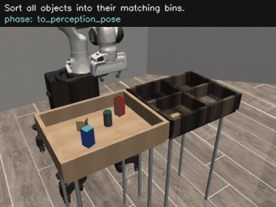
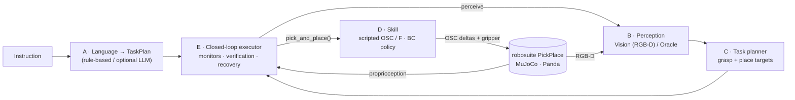
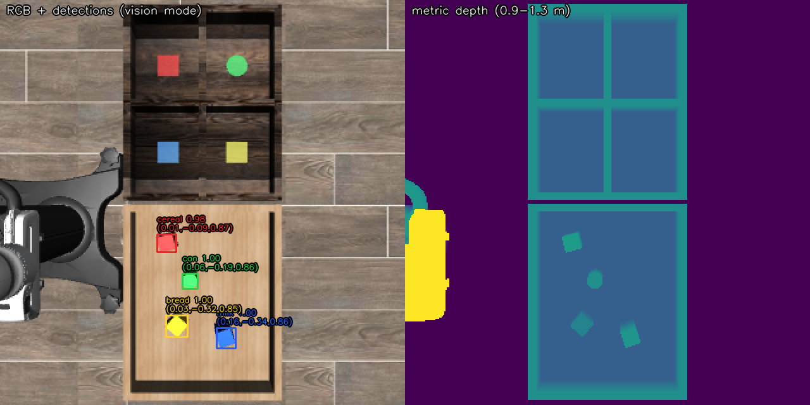
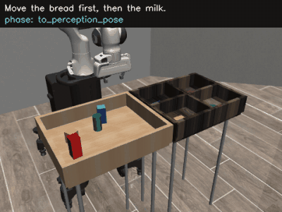
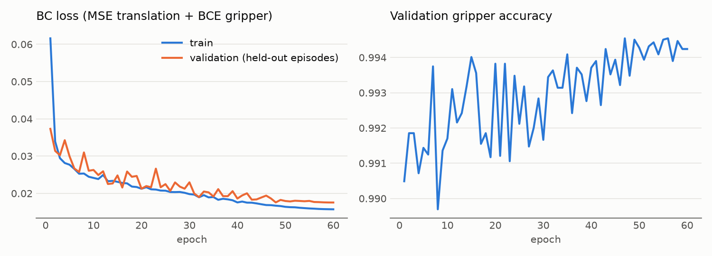
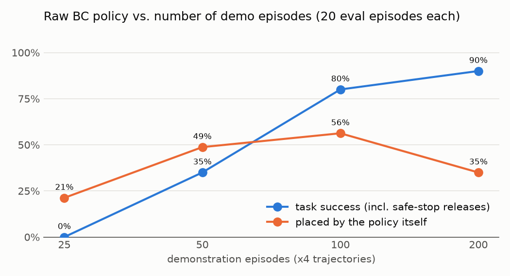
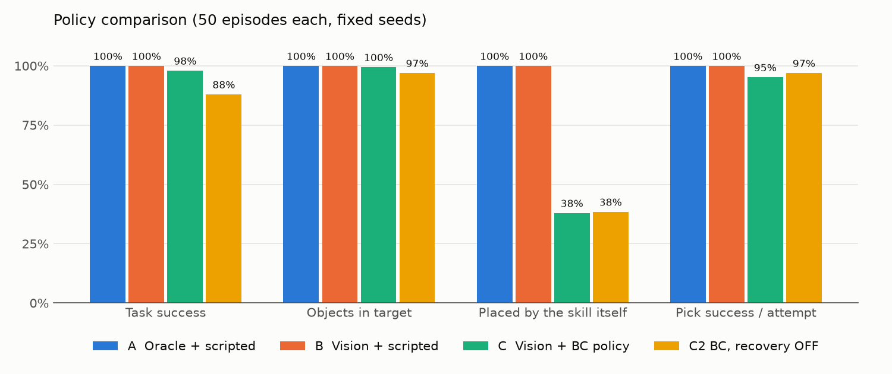
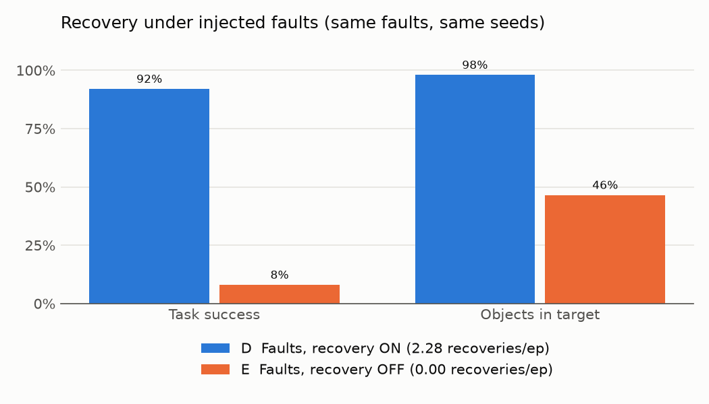
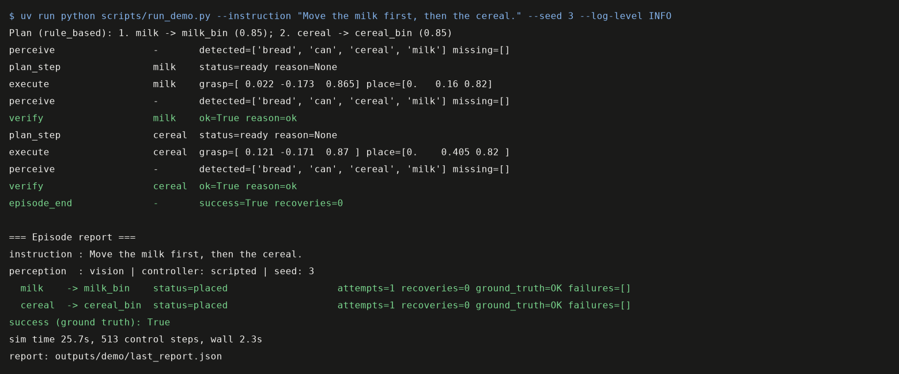

# vla-manipulation-sim

**Language-Guided Robotic Manipulation with Closed-Loop Visual Feedback and Failure Recovery**

A simulated Franka Panda that takes a natural-language instruction, perceives the scene with an
RGB-D camera, plans an ordered sequence of pick-and-place actions, executes them through
physics, checks every step, recovers from failures — and can swap its hand-written controller for
a behaviour-cloning policy trained on its own demonstrations.  Built on **robosuite 1.5 /
MuJoCo 3.3**; runs on a laptop CPU (developed on an Apple M1 Max), no GPU and no robot needed.



**Results (50 fixed unseen seeds per configuration, simulator ground truth):** RGB-D vision +
scripted control sorted all four objects in **50/50** episodes, identical to the Oracle upper
bound (mean 3D localisation error 1.5 mm). Under injected gripper slips and grasp-target errors,
closed-loop recovery raised task success from **8 % to 92 %**. A behaviour-cloning policy trained
on 200 demo episodes reaches 88 % raw task success, but places only 38.5 % of objects by
itself — the rest land when the executor's safe stop opens the gripper; this failure mode is
analysed below rather than hidden.

---

## 1. Project overview

| | |
|---|---|
| **Input** | free-form instruction, e.g. *"Move the milk first, then the cereal."* |
| **Sensors** | calibrated overhead RGB-D camera + robot proprioception |
| **Robot** | Franka Panda, robosuite `OSC_POSE` operational-space controller, 20 Hz |
| **Task** | robosuite `PickPlace`: sort milk / bread / cereal / can from a source bin into four target compartments |
| **Output** | physical manipulation + a structured execution log (every perception, plan, action, check and recovery) |

Every module is a separate package with a typed interface, so each can be tested and replaced
on its own (see [docs/ARCHITECTURE.md](docs/ARCHITECTURE.md)).

## 2. Problem statement

Language-conditioned manipulation demos often hide three hard parts: (1) grounding words to
objects that must be *found* by perception, (2) noticing when the physical world did not do what
the plan assumed, and (3) recovering instead of failing silently.  This project builds the full
loop end to end with honest measurement:

* the robot never reads simulator object state in **Vision mode** — positions come from RGB-D;
* objects move only through contact physics (no teleporting, no attached-object tricks);
* success is always scored against simulator ground truth (including robosuite's own
  `PickPlace` success function), separately from what the robot *believes*.

## 3. Architecture



| Module | Package | Key idea |
|---|---|---|
| A · Task understanding | `robotics.language` | Pydantic `TaskPlan`; rule-based parser (no API key); optional Claude parser; unknown objects/targets rejected with explanations |
| B · Visual perception | `robotics.perception` | HSV + depth back-projection to 3D, grasp yaw, occlusion & invalid-depth flags; Oracle mode kept separate |
| C · Task planning | `robotics.planning` | stateless re-planning from fresh perception; reachability, idempotent repetition, wall-aware grasp yaw |
| D · Motion control | `robotics.control` | min-jerk set-points → bounded OSC_POSE deltas, per-segment timeouts, proprioceptive grasp checks |
| E · Feedback & recovery | `robotics.recovery` | drop/empty-grasp/timeout detection, placement verification, safe stop, ≤ 2 recovery attempts |
| F · Imitation learning | `robotics.learning` | scripted-expert demos (DART noise), MLP behaviour cloning, drop-in learned skill |
| Evaluation | `robotics.evaluation` | fixed-seed benchmark → CSV/JSON + plots |

## 4. Technology stack

Python 3.11 · robosuite 1.5.2 · MuJoCo 3.3.7 · PyTorch 2.15 (CPU) · OpenCV 4.11 · NumPy / SciPy ·
Pydantic 2 · Matplotlib · pytest · Ruff · uv (locked dependencies) · GitHub Actions ·
optional Anthropic SDK for the LLM planner.

## 5. Simulation environment

`ColorSortPickPlace` subclasses robosuite's `PickPlace` and keeps its Panda, bins arena, four
object identities, four target quadrants and success function.  Two changes:

1. The textured meshes are replaced by **colour-coded primitives** (blue milk carton, yellow
   bread, red cereal box, green can) so classical vision can classify them reliably without a
   learned detector trained on privileged labels.
2. An **overhead RGB-D camera** is added above both bins (intrinsics from MuJoCo `fovy`,
   extrinsics from the camera pose).

Resets are seeded (object placement and robot joint noise); evaluation seeds (`10000+`) are
disjoint from demonstration seeds (`0-199`).

## 6. Perception pipeline



1. Back-project every valid depth pixel into world coordinates.
2. Keep pixels ≥ 1.5 cm above the bin floor (removes floor, texture and flat container markers).
3. Per category: HSV threshold → morphological opening → largest connected component.
4. Top surface = 90th-percentile height; centre = median of top-surface points;
   `z = (top + floor) / 2`; grasp yaw from the minimum-area rectangle of the top face.
5. Confidence = visible fraction of the expected top area × valid-depth fraction; flags for
   partial occlusion, invalid depth, elongated (toppled) footprints, multiple candidates.

Oracle mode reads MuJoCo body poses and computes the same quantities from geometry; it is a
debugging tool and an upper bound.  The vision backend only holds a reference to the camera
capture function — tests assert it cannot reach object state.

## 7. Task planning

`TaskPlanner.plan_step` turns one `TaskStep` + the latest `PerceptionResult` into
`locate → estimate_pose → select_container → pick → place → verify` with concrete targets, or a
status explaining why not: `object_not_found`, `low_confidence`, `object_unreachable`,
`target_unreachable`, `already_satisfied` (idempotent repeats).  Release points are chosen
inside the target compartment, within the Panda's reach and away from objects already there;
for square objects the planner picks the grasp yaw (`θ` or `θ+90°`) with the larger finger
clearance to bin walls and neighbours.

```text
$ uv run python scripts/run_demo.py --instruction "Put the milk in the fridge."
Could not understand the instruction: Unknown target location(s) ['fridge']. Valid containers: ['bread_bin', 'can_bin', 'cereal_bin', 'milk_bin', 'source_bin'].
Suggestions: ['bread_bin', 'can_bin', 'cereal_bin', 'milk_bin', 'source_bin']
```

## 8. Motion control

robosuite's default Panda controller (`OSC_POSE`, delta commands in the base frame, ≤ 5 cm and
≤ 0.5 rad per step).  The scripted skill follows minimum-jerk set-point segments (peak
0.45 m/s), clips every action, and has a timeout per segment:

`pre-grasp → approach → descend → close → (grasp check) → lift → (hold check) → transport at
safe height → lower → release → retreat`

Collision avoidance is structural (vertical approach/retreat, transport above the 0.90 m bin
walls, workspace clipping, wall-aware yaw); robot-scene contacts are counted as a metric.

## 9. Failure recovery

| Detected failure | How |
|---|---|
| empty grasp | finger gap < 1.2 cm after closing |
| drop during lift / transport | finger gap leaves the holding band (proprioception, 2-step debounce) |
| blocked / slow motion | per-segment step budget |
| not in target after release | re-perception + container test |
| unreachable / lost / stuck in gripper | planner status, distance to end-effector |
| episode timeout | global step budget → safe abort |

On failure the executor logs the reason, opens the gripper and retreats, re-perceives,
re-plans and retries (max **2** recovery attempts per step), then moves on to the next step.
For stress testing, a fault injector produces *physical* failures: a gripper actuator glitch
that drops the object mid-transport and a 4 cm grasp-target corruption.



## 10. Imitation learning

* **Expert data**: the scripted controller runs the full closed loop on demo seeds; every
  control step records `observation, action, timestamp, task_id`; only attempts verified as
  successful are kept; half the episodes use DART-style noise on executed actions (labels stay
  clean) so the data contains corrections.
* **Observation (17-D)**: end-effector position, grasp target and place target relative to the
  end-effector, top-surface offset, finger gap, previous gripper command, a proprioceptive
  "object held" latch and the object one-hot.  End-effector velocity is also recorded (20-D) but
  excluded by default — see the copycat ablation below.  No live object state — the policy
  consumes the same perceived targets as the scripted skill, so it runs in Vision mode.
* **Policy**: 3×256 MLP with LayerNorm; translation regressed (tanh, MSE), gripper as binary
  classification (BCE).  Episode-level train/validation split; normaliser fit on train only.
* **Deployment**: `BCPickPlaceSkill` has the same interface as the scripted skill, so the
  same executor, monitors and recovery wrap it.

**Data**: 200 demo episodes (seeds 0–199) → 798 verified trajectories, 177 k control steps.
**Training**: 60 epochs, 90 s on CPU; validation (30 held-out episodes) translation MSE 0.0038,
gripper accuracy 99.4 %.



| Raw BC (recovery off, 50 ep.) | without velocity (default) | with velocity (ablation) |
|---|---|---|
| Task success (ground truth) | 88 % | 38 % |
| Objects in target | 97 % | 79.5 % |
| Placed by the policy itself | 38.5 % | 78 % |

* The policy reaches, grasps (97 % pick success) and transports reliably, but usually **hovers
  just above the release height without opening** — a fixed point of a memoryless policy where
  the expert's actions are near zero and the open/close switch is rare.  The 450-step skill
  timeout fires and the executor's safe stop releases the object, so ground-truth success is
  high while the robot itself (correctly) reports a skill failure.
* Adding end-effector velocity lets the policy release by itself (78 %) but makes it copy its
  own past motion (the classic *copycat* / causal-confusion effect): it times out elsewhere and
  collides more.  Offline metrics improved while closed-loop success fell — offline accuracy
  was not a reliable proxy.
* **Generalisation**: all evaluation seeds are unseen layouts.  More data helps
  (task success 0 % → 35 % → 80 % → 90 % for 25 / 50 / 100 / 200 demo episodes, 20 episodes
  each) while the self-completed placement rate stays at 21–56 %.  Reversing the instruction
  order (never seen in demos) drops raw BC from 90 % to 70 %, while the scripted pipeline stays
  at 100 %.



Full analysis: [docs/EXPERIMENTS.md](docs/EXPERIMENTS.md).

## 11. Benchmark results

Instruction *"Sort all objects into their matching bins."*, 50 episodes per configuration,
seeds 10000–10049 (never used for demonstrations), Apple M1 Max CPU.  All numbers are produced
by `scripts/evaluate.py` and `scripts/visualize_results.py`; raw CSV/JSON (with seeds, config,
versions, commit) land in `outputs/`.

| Config | Episodes | Task success | Objects in target | Placed by skill itself | Pick success / attempt | Avg recoveries | Collision rate | Avg pick-place actions | Avg duration (sim s) | Avg wall time (s) | Self-check agreement |
|---|---|---|---|---|---|---|---|---|---|---|---|
| A  Oracle + scripted | 50 | 100.0% | 100.0% | 100.0% | 100.0% | 0.00 | 2.0% | 4.00 | 54.5 | 4.8 | 100.0% |
| B  Vision + scripted | 50 | 100.0% | 100.0% | 100.0% | 100.0% | 0.00 | 2.0% | 4.00 | 54.6 | 4.7 | 100.0% |
| C  Vision + BC policy | 50 | 98.0% | 99.5% | 38.0% | 95.2% | 2.60 | 6.0% | 4.18 | 89.4 | 8.2 | 96.0% |
| C2 BC, recovery OFF | 50 | 88.0% | 97.0% | 38.5% | 97.0% | 0.00 | 4.0% | 4.00 | 84.5 | 7.3 | 12.0% |
| D  Faults, recovery ON | 50 | 92.0% | 98.0% | 96.5% | 80.1% | 2.28 | 14.0% | 6.22 | 74.8 | 6.4 | 100.0% |
| E  Faults, recovery OFF | 50 | 8.0% | 46.5% | 46.0% | 72.5% | 0.00 | 2.0% | 4.00 | 45.6 | 3.9 | 100.0% |

* **A vs B** — Vision mode matches the Oracle upper bound: 200/200 objects placed, zero
  recoveries.  robosuite's own `PickPlace._check_success` agreed with our ground-truth metric in
  every episode of every configuration.  The single contact episode (2 %) is an object lying
  next to two bin walls, where the hand housing brushes a wall top.
* **D vs E** — identical injected faults (30 % gripper slip during transport, 30 % 4 cm grasp
  offset, first attempt of each step): recovery turns 8 % into 92 % task success for 2.28
  recovery attempts and 20 s per episode; the robot's verdict matched ground truth in 100 % of
  episodes.
* **C / C2** — see Imitation Learning above: high task success, low self-completion.







## 12. Installation

Requirements: macOS (Apple Silicon or Intel) or Linux, [uv](https://docs.astral.sh/uv/) ≥ 0.9.
uv installs Python 3.11 and the locked dependencies.

```bash
git clone https://github.com/OHMFOHS/vla-manipulation-sim.git
cd vla-manipulation-sim
uv sync
```

Optional LLM planner: `uv sync --extra llm` and set `ANTHROPIC_API_KEY` (see `.env.example`).
Headless Linux needs `libosmesa6` and `MUJOCO_GL=osmesa PYOPENGL_PLATFORM=osmesa`
(see [docs/TROUBLESHOOTING.md](docs/TROUBLESHOOTING.md)).

## 13. Usage

```bash
# run the robot (headless, vision mode) and print the execution report
uv run python scripts/run_demo.py
uv run python scripts/run_demo.py --instruction "Move the milk first, then the cereal." --seed 3

# watch it: OpenCV window (any mode) or the native MuJoCo viewer on macOS (oracle mode)
uv run python scripts/run_demo.py --gui
./scripts/mjpython.sh scripts/run_demo.py --gui --perception oracle

# record a GIF, exercise recovery with injected faults, use the LLM planner
uv run python scripts/run_demo.py --record outputs/demo/run.gif --faults
uv run python scripts/run_demo.py --planner auto --instruction "please tidy the cereal and the can"

# benchmark (50 fixed seeds per configuration)
uv run python scripts/evaluate.py --episodes 50
uv run python scripts/evaluate.py --episodes 50 --configs D_vision_scripted_faults E_vision_scripted_faults_norecovery

# imitation learning
uv run python scripts/collect_demos.py --episodes 100
uv run python scripts/train_bc.py
uv run python scripts/run_demo.py --controller bc

# plots + markdown table from benchmark outputs
uv run python scripts/visualize_results.py

# quality gates
uv run ruff check . && uv run ruff format --check .
uv run pytest
```

Common flags: `--seed`, `--perception {vision,oracle}`, `--controller {scripted,bc}`,
`--log-level {DEBUG,INFO,WARNING}`.  Configuration lives in `configs/*.yaml`.

### Tests

`pytest` runs unit tests (language, schema, perception on synthetic RGB-D, trajectories, OSC
mapping, planning, monitors, fault injection, metrics, BC components) and integration tests on
**real MuJoCo physics** — no mocks for the core loop: deterministic resets, the action frame,
RGB-D capture, a physical pick-and-place, empty-grasp detection, vision-vs-oracle accuracy,
language-to-placement, recovery after an injected slip, recovery disabled, episode timeout,
idempotent repetition, benchmark output files, and collect → train → deploy BC.

## 14. Limitations

* **Colour-coded objects.**  The textured robosuite meshes were replaced by colour-coded
  primitives so classical HSV segmentation works; the vision pipeline would not handle the
  original meshes, clutter of identical colours, or lighting changes without a learned detector.
  Perception accuracy numbers are specific to this scene.
* **One instance per category** is assumed by the detector (largest component wins).
* **Scripted motion strategy, not a motion planner.**  Collision avoidance is structural (vertical
  approach, safe transport height, wall-aware grasp yaw).  One benchmark episode still has a brief
  hand/wall contact when an object lies near two walls; objects toppled against a wall can be
  ungraspable and are abandoned after two retries.
* **Reach limits.**  The far target compartment is at the edge of the Panda's reach from its
  robosuite base pose; release points are pulled toward the robot inside the compartment.
* **Behaviour cloning does not release objects reliably** (see above); its high task success
  depends on the executor's timeout and safe stop.  The policy is conditioned on perceived
  targets, not on images.
* **Fault injection is synthetic** (actuator glitch, target offset); it exercises detection and
  recovery but is not a model of real-world failure statistics.
* **Native MuJoCo viewer on macOS** only works in Oracle mode (robosuite's offscreen renderer
  conflicts with `mjpython`); the OpenCV viewer works in both modes.
* **LLM planner** is implemented and unit-tested with a fake client, but was not benchmarked
  (no API calls were made while building this project).
* Simulation only; no sim-to-real transfer was attempted.

## 15. Future work

See [docs/ROADMAP.md](docs/ROADMAP.md): ACT (action chunking with transformers),
image-conditioned policies, a learned detector for the original textured meshes, domain
randomisation, sampling-based motion planning, more robots and tasks, and an evaluation set for
the LLM planner.

## Repository layout

```
configs/            simulation.yaml · perception.yaml · training.yaml
src/robotics/       language · perception · planning · control · recovery · learning · evaluation · simulation · common
scripts/            run_demo · evaluate · collect_demos · train_bc · visualize_results · perception_snapshot · mjpython.sh
tests/              unit/ · integration/  (real physics)
docs/               ARCHITECTURE · EXPERIMENTS · ROADMAP · TROUBLESHOOTING
assets/             demo GIFs, perception snapshot, result plots
outputs/            generated data, checkpoints and benchmark results (git-ignored)
```

## License

MIT — see [LICENSE](LICENSE).
