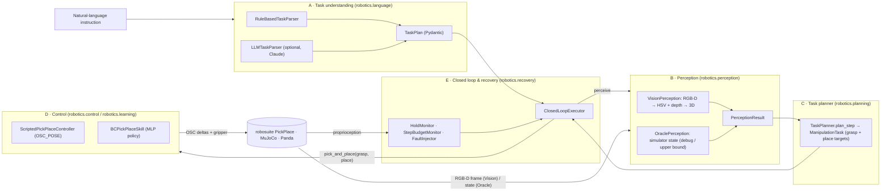

# Architecture

The system is a pipeline of six loosely coupled modules.  Each module owns one data type and
talks to the others only through it.  Nothing downstream of perception can see simulator
object state in Vision mode.

## Data contracts

| Type | Producer → consumer | Content |
|---|---|---|
| `TaskPlan` / `TaskStep` | language → executor | object name, target container, execution order, action type, confidence |
| `RGBDFrame` | `SimEnv.capture_rgbd` → vision | RGB, metric depth, intrinsics, camera pose — **no object state** |
| `PerceptionResult` / `Detection` | perception → planner | category, 3D centre, top height, grasp yaw, bbox, confidence, flags |
| `ManipulationTask` | planner → executor | status + primitive sequence (locate, estimate pose, select container, pick, place, verify) + `GraspTarget` / `PlaceTarget` |
| `SkillResult` | skill → executor | success, failing phase, reason, steps |
| `EpisodeReport` | executor → evaluation | per-step outcomes, event log, recovery counts, ground truth (evaluation only) |

## Module notes

### A · Task understanding
* `RuleBasedTaskParser` splits the instruction into clauses at sequencing words, finds object
  mentions (aliases, longest match first, fuzzy fallback for typos) and target phrases
  (designated / explicit / spatial container names), then applies order modifiers
  (`first`, `then`, `after`, `before`, `last`) and removes duplicates.
* Unknown objects (`"banana"`) and targets (`"the fridge"`) raise `PlanningError` with a
  machine-readable code and a human explanation.
* `LLMTaskParser` sends the instruction, the object catalogue and the container list to Claude
  and requests structured output; the response is validated by the same Pydantic models, so an
  LLM cannot introduce an object or container that does not exist.  The LLM never produces
  coordinates or joint angles.

### B · Perception
* The overhead camera is added to the robosuite model at `pos=(0.1, 0.015, 2.0)`, looking
  straight down; intrinsics come from MuJoCo's `fovy`, extrinsics from the camera pose
  (sensor calibration, not object state).
* Vision algorithm: valid-depth mask → back-project every pixel to world → keep pixels raised
  ≥ 1.5 cm above the bin floor → HSV threshold per class → morphology → largest connected
  component → top surface (90th percentile height) → centre = median of top-surface points,
  `z = (top + floor)/2` → grasp yaw from the minimum-area rectangle of the top face.
* Confidence = visible fraction of the expected top-face area × fraction of valid depth.
  Flags: `partially_occluded`, `invalid_depth_pixels`, `elongated_footprint`,
  `multiple_candidates`, `not_on_support_surface`.
* Oracle mode reads body poses and computes the same quantities from geometry.
  `VisionPerceptionBackend` only stores `env.capture_rgbd`, never the environment.

### C · Task planner
Stateless: called before every attempt with fresh perception.  It returns one of
`ready`, `already_satisfied` (idempotent repetition), `object_not_found`, `low_confidence`,
`object_unreachable`, `target_unreachable`.  For ready steps it chooses

* a release point inside the target container that is within the Panda's comfortable reach
  and away from objects already placed there (`planning/placement.py`);
* a grasp yaw (`yaw` or `yaw + 90°` for square objects) that maximises finger clearance to
  bin walls and neighbouring objects (`planning/grasp_selection.py`).

### D · Motion planning and control
robosuite's default Panda controller (`OSC_POSE`, delta input, base frame).  The scripted skill
generates minimum-jerk set-point segments (peak speed 0.45 m/s) and tracks them with a bounded
proportional law; actions are clipped to the OSC limits (5 cm, 0.5 rad per step).  Every segment
has a timeout.  Collision avoidance is structural: vertical approach/retreat, transport at a
safe height above the bin walls, workspace clipping, wall-aware grasp yaw.

The learned `BCPickPlaceSkill` has the same interface (`pick_and_place(grasp, place)`), so the
executor and recovery logic are reused unchanged.

### E · Closed loop and recovery
For each step: perceive → plan → execute (monitored) → perceive → verify.  Failures detected:

| Failure | Detector |
|---|---|
| empty grasp | finger gap below 1.2 cm after closing |
| drop during lift / transport | `HoldMonitor`: finger gap outside the holding band (2-step debounce) |
| segment timeout / blocked motion | per-segment step budget |
| object not in target after release | re-perception + container containment test |
| object lost / unreachable / stuck in gripper | planner status, distance to the end effector |
| episode timeout | `StepBudgetMonitor` (global) |

On failure: log the reason → safe stop (open gripper, retreat vertically) → re-perceive →
re-plan → retry, at most `max_recovery_attempts = 2` times.  Unrecoverable steps end with a
`gave_up:*` status and the executor continues with the next step (partial completion).

### F · Imitation learning
See [EXPERIMENTS.md](EXPERIMENTS.md).  Features (17-D): end-effector position, grasp target
relative to the end effector, top-surface offset, place target relative to the end effector,
finger gap, previous gripper command, a proprioceptive "object held" latch and the object
one-hot.  The policy never sees live object poses — it consumes the same targets the scripted
controller receives, so it runs in Vision mode.

## Why the colour-coded scene?
robosuite's default PickPlace meshes (milk carton, bread, cereal box, can) are textured and
hard to classify with classical OpenCV.  The project keeps PickPlace's arena, robot, bins,
object identities, target quadrants and success function, and only swaps the meshes for
colour-coded primitives (`ColorSortPickPlace`).  This keeps Vision mode honest (no learned
detector pretrained on privileged labels) and the benchmark comparable to robosuite's
official success criterion, which every evaluation also reports.
