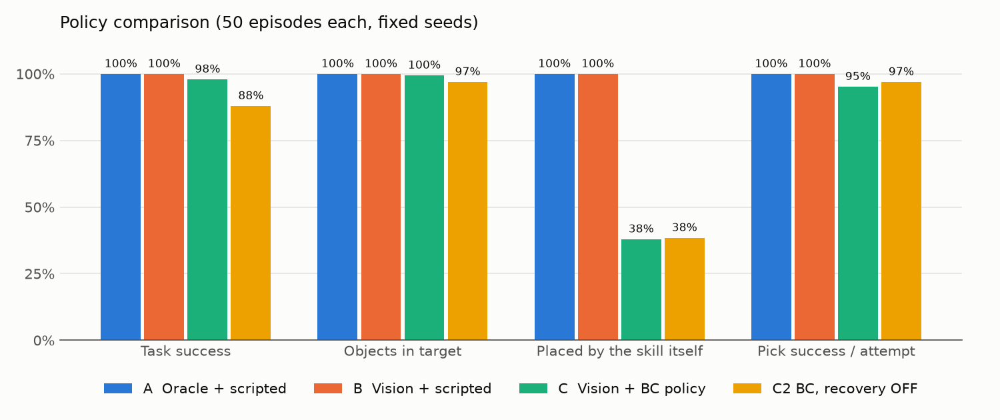
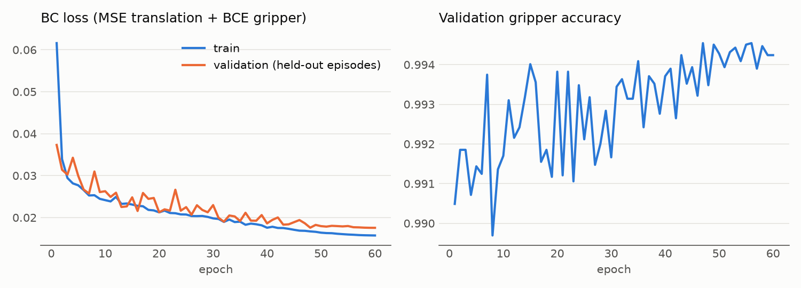
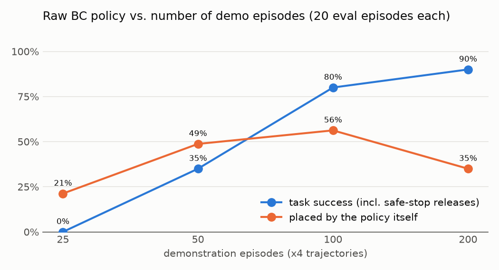
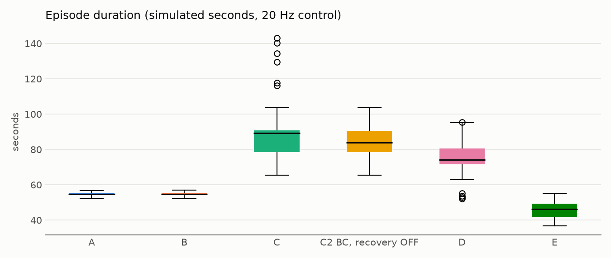

# Experiments

All numbers in this document were produced by the scripts in this repository on an Apple M1
Max (CPU only), robosuite 1.5.2, MuJoCo 3.3.7, PyTorch 2.15.  Raw outputs (per-episode CSV,
JSONL execution logs, summary JSON with seeds, configuration, library versions and git commit)
are written to `outputs/` by the commands quoted in each section.  Nothing here is estimated or
copied from elsewhere.

## Protocol

* **Task**: instruction *"Sort all objects into their matching bins."* — four objects (milk,
  bread, cereal, can), each into its own compartment of the target bin.
* **Seeds**: evaluation seeds `10000-10049` (50 episodes per configuration, identical across
  configurations).  Demonstrations use seeds `0-199`, so evaluation scenes are never seen in
  training.
* **Success**: simulator ground truth at the end of the episode.  *Task success* = all four
  objects in their target compartments; robosuite's own `PickPlace._check_success` is recorded
  alongside and agreed with our metric in every episode reported here.
* **Placed by the skill itself** = fraction of requested objects that ended in the target after a
  skill execution that itself reported success and passed verification.  It excludes objects
  that only landed in the target when a safe stop opened the gripper (relevant for BC, §3).
* **Pick success / attempt** = fraction of pick-and-place executions whose grasp held through
  the lift (proprioceptive check); **placement success** = fraction of requested objects that end
  in the right compartment; **collision rate** = fraction of episodes with any robot–scene contact
  (arm or gripper vs. bins/table, simulator contacts, evaluation-only); **actions** = pick-and-place
  executions per episode (4 is the minimum); **duration** = simulated seconds at 20 Hz.
* **Self-check agreement** = fraction of episodes where the robot's own verdict (from its
  perception and monitors) equals ground truth — a measure of the closed loop's honesty.

## 1. Main benchmark (50 episodes per configuration)

```bash
uv run python scripts/evaluate.py --episodes 50 --configs A_oracle_scripted B_vision_scripted \
    D_vision_scripted_faults E_vision_scripted_faults_norecovery --out-dir outputs/benchmark_scripted
uv run python scripts/evaluate.py --episodes 50 --configs C_vision_bc C2_vision_bc_norecovery --out-dir outputs/benchmark_bc
uv run python scripts/visualize_results.py --benchmark outputs/benchmark_scripted outputs/benchmark_bc
```

| Config | Episodes | Task success | Objects in target | Placed by skill itself | Pick success / attempt | Avg recoveries | Collision rate | Avg pick-place actions | Avg duration (sim s) | Avg wall time (s) | Self-check agreement |
|---|---|---|---|---|---|---|---|---|---|---|---|
| A  Oracle + scripted | 50 | 100.0% | 100.0% | 100.0% | 100.0% | 0.00 | 2.0% | 4.00 | 54.5 | 4.8 | 100.0% |
| B  Vision + scripted | 50 | 100.0% | 100.0% | 100.0% | 100.0% | 0.00 | 2.0% | 4.00 | 54.6 | 4.7 | 100.0% |
| C  Vision + BC policy | 50 | 98.0% | 99.5% | 38.0% | 95.2% | 2.60 | 6.0% | 4.18 | 89.4 | 8.2 | 96.0% |
| C2 BC, recovery OFF | 50 | 88.0% | 97.0% | 38.5% | 97.0% | 0.00 | 4.0% | 4.00 | 84.5 | 7.3 | 12.0% |
| D  Faults, recovery ON | 50 | 92.0% | 98.0% | 96.5% | 80.1% | 2.28 | 14.0% | 6.22 | 74.8 | 6.4 | 100.0% |
| E  Faults, recovery OFF | 50 | 8.0% | 46.5% | 46.0% | 72.5% | 0.00 | 2.0% | 4.00 | 45.6 | 3.9 | 100.0% |

Per-object placement success:

| Config | milk | bread | cereal | can |
|---|---|---|---|---|
| A  Oracle + scripted | 100% | 100% | 100% | 100% |
| B  Vision + scripted | 100% | 100% | 100% | 100% |
| C  Vision + BC policy | 100% | 98% | 100% | 100% |
| C2 BC, recovery OFF | 100% | 88% | 100% | 100% |
| D  Faults, recovery ON | 100% | 100% | 100% | 92% |
| E  Faults, recovery OFF | 40% | 60% | 48% | 38% |

Seeds 10000..10049 · commit(s) 046a7c8 · robosuite 1.5.2, MuJoCo 3.3.7, torch 2.15.0, Python 3.11.14




Observations

* **Scripted control (A, B)** completed all 50 episodes in both modes — 200/200 objects,
  zero recoveries needed, and robosuite's own `_check_success` agreed with our ground-truth
  metric in every episode.  **Vision mode matches Oracle mode**: perception is not the bottleneck
  in this scene (see §2).
* The 2 % collision rate in A/B is a single episode (seed 10031) where an object lies close to two
  source-bin walls and the Panda hand housing brushes a wall top while descending (see §5).
* **Recovery (D vs E)**: with identical injected faults (30 % gripper-slip probability and 30 %
  grasp-target corruption on each step's first attempt), recovery raises task success from
  **8 % to 92 %** and objects-in-target from 46.5 % to 98 %, at a cost of 2.28 recovery attempts and
  20 extra simulated seconds per episode.  The robot's own verdict matched ground truth in every
  D and E episode (self-check agreement 100 %), i.e. no failure went unnoticed.  The 4 failed D
  episodes each lost one object after a drop left it in a pose the retries could not handle
  (two with descend timeouts — typically an object toppled against a wall —, one pre-grasp
  timeout, one with repeated drops during the lift).
* **Behaviour cloning (C, C2)**: see §3 — the headline task success (98 % / 88 %) is real but
  misleading on its own, which is why the table also reports *placed by the skill itself*.

## 2. Perception accuracy (Vision mode)

```bash
uv run python scripts/perception_snapshot.py --accuracy-episodes 50
```

Over the 50 evaluation seeds (200 objects) the RGB-D pipeline detected **100 %** of objects.
3D centre error vs. ground truth: mean **1.46 mm**, median 1.40 mm, 95th percentile 2.57 mm,
max 2.99 mm (per object: milk 1.52, bread 1.48, cereal 1.32, can 1.53 mm).  Errors are dominated
by pixel quantisation (≈ 3.5 mm per pixel at 320×320) and are far below the grasp tolerance of
the parallel gripper, which is why A and B perform identically.  This reflects the colour-coded
scene (see Limitations): it does not claim that the HSV pipeline generalises to textured objects.

## 3. Behaviour cloning

Data: `collect_demos.py --episodes 200` (seeds 0–199) → 798 successful pick-and-place
trajectories, 176,977 control steps; 10 attempts were discarded because ground truth showed the
object did not end in its target.  Half of the episodes used DART-style noise
(σ = 0.15 on executed translation actions).  Training: 170 episodes train / 30 episodes
validation (episode-level split), 60 epochs, 90 s on CPU.  Best validation: translation MSE
0.0038, gripper accuracy 99.42 %.



### 3.1 Closed-loop result and what it really means

| | C (BC + recovery) | C2 (raw BC) | B (scripted) |
|---|---|---|---|
| Task success | 98 % | 88 % | 100 % |
| Objects in target | 99.5 % | 97 % | 100 % |
| **Placed by the skill itself** | **38 %** | **38.5 %** | 100 % |
| Avg duration | 89.4 s | 84.5 s | 54.6 s |

The policy grasps reliably (95–97 % pick success) and carries objects to the right compartment,
but in most placements it **stops a few millimetres above the release height and never opens
the gripper** — a fixed point of a memoryless policy: close to the goal the expert's actions are
near zero, and the open/close switch is a rare, sharp transition in the data.  The skill then
hits its 450-step timeout, and the executor's *safe stop* (open gripper, retreat) drops the object
the last few centimetres into the compartment.  The executor correctly reports this as a skill
failure (`bc_timeout`), so C2's self-check agreement is only 12 % while ground truth says 88 % of
episodes ended with every object placed.  With recovery enabled (C), the re-perception after the
safe stop sees the object in place (`already_satisfied`), so C's belief matches ground truth
(96 %) but no episode was completed by the policy alone.

**Conclusion**: the learned policy has learned reaching, grasping and transport; it has *not*
learned to release.  The high task success is a property of the closed-loop system (timeouts +
safe stop + verification), not of the policy.

### 3.2 Ablation: end-effector velocity feature (copycat effect)

Adding the finite-difference end-effector velocity to the observation is the textbook fix for a
memoryless policy that cannot tell "still moving" from "arrived".  Offline it helps (validation
gripper accuracy 99.74 % vs 99.42 %, translation MSE 0.0028 vs 0.0038).  In closed loop
(raw BC, 50 episodes):

| | without velocity (default) | with velocity |
|---|---|---|
| Task success | 88 % | 38 % |
| Objects in target | 97 % | 79.5 % |
| Placed by the skill itself | 38.5 % | **78 %** |
| Collision rate | 4 % | 18 % |

The velocity policy *does* learn to release (78 % of objects placed by the policy, 16/50
episodes completed entirely by the policy), but on 41 objects it times out without placing
them.  Velocity nearly encodes the previous action, so the network partly copies its own
past motion instead of reacting to the goal — the "copycat" / causal-confusion problem known
from the imitation-learning literature.  It is recorded in the dataset but excluded by default
(`exclude_features` in `configs/training.yaml`).

```bash
sed 's/^exclude_features:.*/exclude_features: []/' configs/training.yaml > outputs/training_with_velocity.yaml
uv run python scripts/train_bc.py --config outputs/training_with_velocity.yaml --out-dir outputs/ablation/bc_velocity
uv run python scripts/evaluate.py --episodes 50 --configs C2_vision_bc_norecovery \
    --checkpoint outputs/ablation/bc_velocity/bc_policy.pt --out-dir outputs/ablation/eval_velocity
```

### 3.3 Generalisation

**Amount of data** (raw BC, 20 evaluation episodes each, first N demo episodes):

| demo episodes | 25 | 50 | 100 | 200 |
|---|---|---|---|---|
| Task success | 0 % | 35 % | 80 % | 90 % |
| Placed by the policy itself | 21 % | 49 % | 56 % | 35 % |



More data steadily improves reaching/grasping/transport (so the safe-stop release succeeds more
often), but the release decision does not improve monotonically — consistent with the
fixed-point diagnosis rather than a lack of data.

**Changed task order** (`"Move the can first, then the cereal, then the bread, then the milk."`,
20 episodes): the scripted pipeline stays at 100 %; raw BC drops from 90 % to **70 %** task success
(92.5 % objects in target, 34 % placed by the policy itself).  The demonstrations always sorted
milk → bread → cereal → can, so other objects are in different places at each pick; the policy
is sensitive to that context shift even though its inputs contain no other-object information
— the shift enters through the different grasp/place target combinations and arm postures.

**Unseen scenes**: all evaluation seeds (10000+) are disjoint from the training seeds (0–199), so
every number above is on unseen object layouts.

### 3.4 Earlier iterations (kept for transparency)

During development, a first BC run (before the arm-posture fix in §5 changed the expert's
retreat motion) produced the same hover-without-release failure; those checkpoints were
discarded and all numbers above come from the final expert, dataset and code (commit noted in
`outputs/*/summary.json`).

## 4. Episode duration



Scripted episodes take 54.5 s of simulated time for four objects (20 Hz, ≈ 1,090 control
steps) and ≈ 4.7 s of wall time on one CPU core.  BC episodes are longer because of the
timeouts described in §3.1.

## 5. Failure analyses that changed the code

| Symptom (found by the benchmark) | Root cause | Fix |
|---|---|---|
| Robot-scene contacts in 6/50 episodes | Panda hand housing (≈ 21 cm long, wider than the open fingers) grazed source-bin wall tops when grasping near a wall | grasp-yaw selection also checks hand-housing clearance → 1/50 |
| After placing the can in the far-left compartment the arm could not reach anything again | (a) grasp-yaw tie-break chose −90°, pushing the last joint to its 2.9 rad limit; (b) retreating to 1.04 m above the far compartment stretched the arm to its elbow limit (near-singular for OSC) | prefer the smallest feasible wrist rotation; empty-handed retreat at 0.96 m |
| Re-grasp after a drop timed out | object rested against a wall; one finger hit the wall | wall-aware choice between the two square-object grasp yaws |
| Black frames / NaN depth in multi-env processes | robosuite only makes its GL context current once | `SimEnv` re-binds its context before each render |
| BC hovers above the target | see §3.1 | documented; velocity ablation; ACT on the roadmap |

